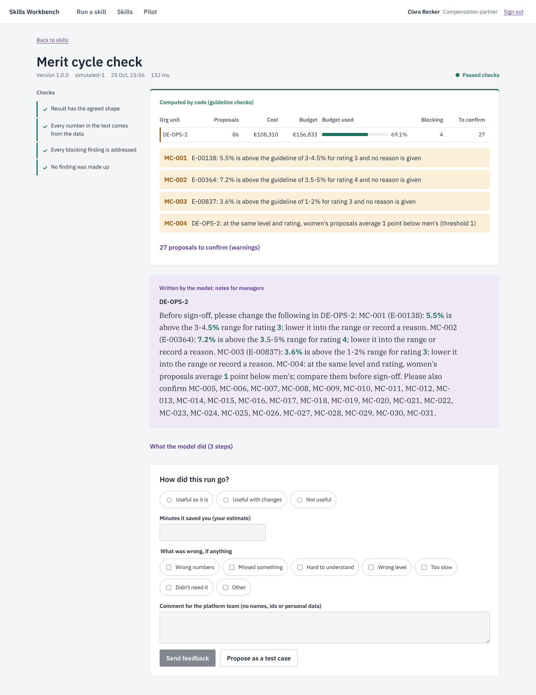
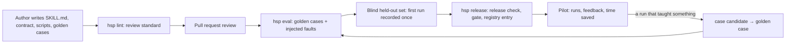

# HR Skills Platform

How a small team builds AI skills for HR and compensation without losing control of them. It
covers what a well-formed skill is, what gets rejected in review, how a skill is versioned and
released, what data a model may see, and how the team knows a skill works before people rely on
it.

The platform runs on an invented company, Nordwerk Mobility: 1,220 people in Germany and
Portugal, with pay gaps deliberately built into its data. It ships three skills:

| Skill | What it does | Who may use it | Where AI fits, and where it does not |
|---|---|---|---|
| **pay-gap-report** | Computes the EU Pay Transparency Directive (2023/970) Art. 9 indicators for one entity and year. Flags categories with a gap of 5% or more (Art. 10). Drafts a memo for HR leadership. | People analytics, compensation, HR leadership | Code computes every figure, with groups of under six women or men suppressed. The model only explains the figures. |
| **merit-cycle-check** | Checks merit proposals against the guideline matrix, band maximums, unit budgets, and a comparison of women's and men's proposals at the same level and rating. Writes one note per manager. | Compensation partners, HR business partners | Code decides what breaks a rule; the model writes the notes. Nobody's raise is decided by either. |
| **job-levelling** | Proposes a job's family and level (L1-L6) from its description, quoting the description for each criterion. | Compensation, HR business partners, recruiters | Reading unstructured text is where a model earns its place. The skill is advisory, and a review is mandatory when it is unsure. |



## What is in it

| Part | What it does | Where |
|---|---|---|
| **The skill format** | Each skill follows the open [Agent Skills](https://agentskills.io/specification) format (`SKILL.md`, `scripts/`, `references/`, `assets/`). It adds a **contract** covering inputs, output, data classification, audience, scripts, validators and acceptance thresholds. | `skills/*/`, `packages/skill-kit/src/contract.ts` |
| **The review standard, as code** | 12 lint rules. Examples: a description that says when to use the skill; required Steps, Output and Boundaries sections; every script tested and named in the instructions; one version everywhere; aggregate skills use the aggregate policy; no personal data or secrets in any file. | `docs/SKILL_STANDARD.md`, `packages/skill-kit/src/lint.ts` |
| **Versioning and backwards compatibility** | A contract diff sorts each change into major, minor or patch, with separate rules for inputs (callers send them) and outputs (callers read them). A wider audience or a removed check also needs a data-protection review. Releases are recorded in `registry/` and pinned by content hash. | `packages/skill-kit/src/compat.ts`, `registry.ts` |
| **One MCP server, the data boundary** | Every client gets the same tools under the same rules: Claude Code over stdio, remote clients over Streamable HTTP, and the platform's own harness in-process. Reference tools serve every HR role. Each skill script becomes a tool only for the roles in its audience. Aggregate results that would show an employee id, or pay for a group of under six women or men, are withheld. | `packages/hr-mcp/` |
| **Provider-neutral harness** | Runs a skill as an agent: it reads the instructions, calls scripts and tools over MCP, and submits a result. It works with Anthropic, any OpenAI-compatible endpoint, or a simulated model for CI. Figures marked `x-from` are copied from script results **by code**, so the model cannot alter them. Seven deterministic validators then check the output. | `packages/harness/` |
| **Evaluation layer** | Golden cases with acceptance criteria. Injected faults: each skill's simulated model makes named mistakes, and every one must be held. Blind held-out sets, written from the reference documents only, have first runs that are recorded once. A gate applies each skill's own thresholds and blocks regressions against its last release. | `packages/evals/`, `skills/*/evals/`, `reports/evals/` |
| **API** | NestJS on PostgreSQL. Skill runs go on a queue claimed with `FOR UPDATE SKIP LOCKED` (multi-instance, with lost runs requeued). Role checks use each skill's audience. Pilot feedback refuses personal data. A run can be proposed as a golden case. Includes a pilot summary and an append-only audit trail. | `apps/api/` |
| **Workbench** | Shows each result in three layers: the checks it passed, what code computed (ledger green), and what the model wrote (plum serif, with every figure in it marked as confirmed). Also shows each skill's release ladder, the pilot figures, and the audit trail. | `apps/console/` |
| **Claude Code plugin** | The repository is a plugin and a marketplace: the `skills/` directory plus the `hr` MCP server. | `.claude-plugin/`, `.mcp.json` |

## Results

All figures come from `reports/evals/`. Held-out sets were written by someone who had seen none
of the code, only the reference documents (`evals/WRITING_HELDOUT.md`). Their first runs are
recorded once, and CI checks that.

| Skill | Golden cases | Injected mistakes held | Blind held-out set, first run |
|---|---:|---:|---|
| pay-gap-report | 13/13 | 48/48 | **19/19** small companies: the indicators and findings match the hand calculation |
| merit-cycle-check | 13/13 | 39/39 | **25/25** merit cycles: exactly the findings derived by hand from the guideline |
| job-levelling | 16/16 | 75/75 | 50 job descriptions: **level exact 28%, within one level 68%, family 82%** (golden: 73%, 100%, 100%) |

What this says:

- **The deterministic parts are right on cases nobody tuned them on.** Every number a pay or
  merit result contains is computed by code. The blind sets show that the code computes what the
  policy and the Directive say.
- **The validators hold every mistake the simulated model was told to make.** The mistakes
  include invented figures, skipped scripts, leaked employee ids, quoted figures for a
  suppressed group, invented findings, invented quotes, unknown levels, and "low confidence"
  without a review.
- **The levelling baseline does not generalise.** The simulated model is a transparent heuristic
  over extracted signals. It scored 73% exact on its author's own examples and 28% on blind ones.
  So job-levelling is **not released**: the skill must be measured with a real model on the
  held-out set first. The harness supports a real model (`AI_PROVIDER=anthropic`), but no model
  key was available here, so **no language model's quality has been measured in this
  repository**. The checks and guarantees are what is proven.
- **Releases**:
  - pay-gap-report and merit-cycle-check went out as 1.0.0 through `hsp release`;
  - they went out again as 1.0.1 after a documentation change, because the release check
    refuses changed content without the version bump it needs.

Tests: 68 for the platform (unit, MCP over stdio and HTTP, API on PostgreSQL) and 11 for the
workbench. CI runs them, the audit (0 known vulnerabilities in production dependencies), lint,
the release check, the evaluation gate and the first-run immutability check. It then builds the
image, boots it on PostgreSQL and runs a skill end to end.

## Run it

```bash
docker compose up --build      # http://localhost:3000, pick an invented person
```

A real model, instead of the simulated one:

```bash
AI_PROVIDER=anthropic AI_MODEL=claude-sonnet-5-5 ANTHROPIC_API_KEY=... docker compose up --build
# or: AI_PROVIDER=openai_compatible AI_BASE_URL=... AI_MODEL=... AI_API_KEY=...
```

Development (Node 22.18+, PostgreSQL 16):

```bash
npm ci && npm run build
npm run hsp -- lint                       # the review standard
npm run hsp -- eval dev && npm run hsp -- gate dev
npm run hsp -- release-check              # what a release of each skill needs
TEST_DATABASE_URL=postgres://... npx vitest run
DATABASE_URL=postgres://... DEMO_LOGIN=1 node apps/api/dist/main.js
cd apps/console && npx vite                # the workbench on :5173, proxied to :3000
```

Measuring a real model on a held-out set (recorded once, with the model in the label):

```bash
AI_PROVIDER=anthropic ANTHROPIC_API_KEY=... npm run hsp -- heldout job-levelling set1
```

In Claude Code:

```text
/plugin marketplace add manojrevenkar12-web/hr-skills-platform
/plugin install hr-skills@hr-skills-platform
```

Then run `npm ci && npm run build` once in the plugin directory: the `hr` MCP server and the
skill scripts need the built packages.

## How a skill gets to users



Decisions are recorded in `docs/adr/`:

- [0001](docs/adr/0001-skills-are-the-unit.md): skills are the unit of reuse and of release.
- [0002](docs/adr/0002-code-computes-model-explains.md): code computes and the model explains.
- [0003](docs/adr/0003-one-mcp-server-is-the-data-boundary.md): one MCP server is the data boundary.
- [0004](docs/adr/0004-provider-neutral-harness.md): build the harness, adopt the standards.
- [0005](docs/adr/0005-evaluation-and-release.md): evaluation and release.
- [0006](docs/adr/0006-what-we-do-not-automate.md): what we do not automate.
- [0007](docs/adr/0007-runs-on-a-postgres-queue.md): runs on a PostgreSQL queue.

A sample client proposal (scope, phases, effort, impact and what is out of scope) is in
[docs/PROPOSAL.md](docs/PROPOSAL.md).

## Limits

- **No language model has been measured.** Every quality figure for prose and for levelling
  comes from a simulated model. The checks hold regardless; how good a real model's notes and
  levels are must be measured on the held-out sets.
- **The number check cannot catch a recommendation that reuses a number from the data.** For
  example, "3.5% would be fair" when 3.5% is the top of the guideline range passes it. The
  boundaries in SKILL.md and human review cover that.
- **Categories of workers are job family × level**, a proxy for work of equal value. A client's
  job evaluation must confirm it. Germany had not transposed the Directive at the time of
  writing (October 2026), so national details may change.
- **The demo sign-in is not authentication.** A client deployment puts its identity provider
  (OIDC) in front of the API and maps HR groups to roles.
- Everything is invented: the company, the people, the pay, the job descriptions and the
  policies.

## Sources

- [Directive (EU) 2023/970 on pay transparency: guide to Art. 9 and 10, and transposition status](https://ravio.com/blog/everything-you-need-to-know-about-the-eu-pay-transparency-directive)
- [Pay transparency transposition tracker, June 2026](https://remoteworkeurope.eu/insights/pay-transparency-transposition-tracker/)
- [AI Act obligations and delays under Omnibus Regulation (EU) 2026/1744](https://www.actuia.com/en/news/ai-act-obligations-in-force-and-delays-under-omnibus-2026-1744/)
- [Gibson Dunn: AI Act omnibus, postponed high-risk deadlines](https://www.gibsondunn.com/eu-ai-act-omnibus-agreement-postponed-high-risk-deadlines-and-other-key-changes/)
- [Agent Skills specification](https://agentskills.io/specification)
- [Claude Code plugins reference](https://code.claude.com/docs/en/plugins-reference)
- [Model Context Protocol specification](https://modelcontextprotocol.io/specification)
